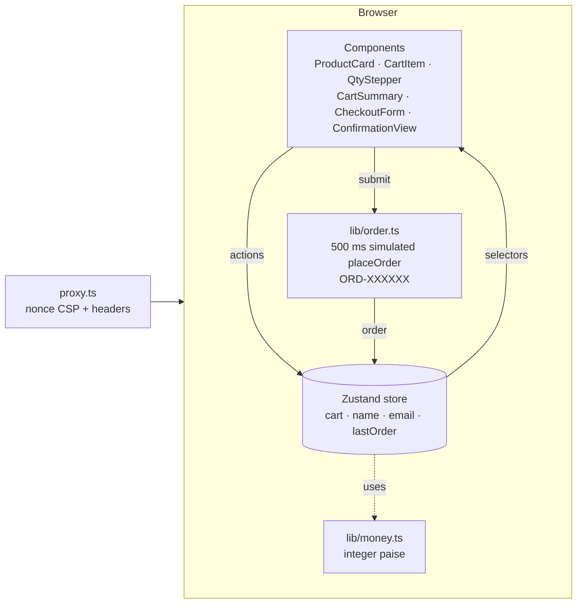
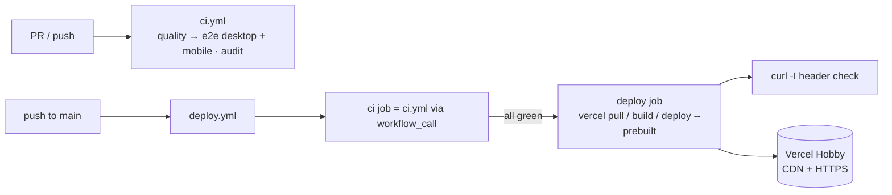

# Apna Bazaar: Mini Checkout + Browser Test Suite

A single-page checkout for a fictional Indian neighbourhood store. It sells two fixed-price products: a **Water Bottle (₹150.00)** and a **Coffee Mug (₹239.00)**. The repo ships with an automated Playwright suite (desktop + mobile), unit tests, a manual test plan with executed results, and secure CI/CD to Vercel's free Hobby tier.

There is no backend, database, payment provider or external call. Everything runs in the browser.

- **Test plan and results:** [TEST-PLAN.md](TEST-PLAN.md)
- **Evidence:** [docs/evidence/](docs/evidence/) (screenshots and Playwright traces, per device)
- **UI design:** generated with Google Stitch ("Riso Memphis Funk" design system). See [docs/design/](docs/design/)
- **Version history:** [CHANGELOG.md](CHANGELOG.md)

## What it does

| Requirement                                                                | Where                                                                                  |
| -------------------------------------------------------------------------- | -------------------------------------------------------------------------------------- |
| Add/remove items, change quantity (− / + / typed)                          | `ProductCard`, `CartItem`, `QtyStepper`                                                |
| Line totals and order total update immediately                             | `lib/store.ts` selectors + `lib/money.ts`                                              |
| Money is exact                                                             | Integer **paise** everywhere. Formatting (`₹1,23,456.00`) only at display              |
| Required name (email optional)                                             | `CheckoutForm`                                                                         |
| Confirmation with reference `ORD-XXXXXX`                                   | `lib/order.ts`, `ConfirmationView`                                                     |
| Empty cart / blank name blocked, clear accessible message, input preserved | `CheckoutForm` (`role="alert"`, focus moves to it)                                     |
| Double-click on Place Order creates one order                              | Synchronous ref lock + disabled/`aria-busy` button during the simulated 500 ms request |
| Quantity: negatives/non-numerics rejected, >99 clamped, 0 removes          | `lib/quantity.ts`                                                                      |

The page is animated throughout: letter drop-in wordmark, ticker, floating parallax shapes, 3D tilt cards, a "+1" token flying into the bag, bouncing totals, error shakes, click sparkles and confetti on confirmation. All motion switches off under `prefers-reduced-motion`. The ticker has a Pause button.

## Run locally

Requires Node ≥ 20.9 (CI uses 22.23.5, see `.nvmrc`).

```bash
npm ci && npm run dev
```

Open http://localhost:3000.

Production build:

```bash
npm run build && npm start
```

## Tests

### Unit tests (money math, quantity rules, store, order reference, CSP)

```bash
npm run test:unit
```

### Browser tests (Playwright)

First time only, install the browser:

```bash
npx playwright install chromium
```

Run the suite headless on **desktop Chrome and a mobile Pixel 7 viewport**:

```bash
npx playwright test
```

Open the interactive UI mode:

```bash
npx playwright test --ui
```

Step through with the inspector:

```bash
npx playwright test --debug
```

Run one device only:

```bash
npx playwright test --project=mobile-pixel7
```

Open the last HTML report:

```bash
npx playwright show-report
```

How the suite works:

- Playwright builds and serves a **production** build on port 3100 (`npm run build:e2e && npm run start:e2e`). That build sets `NEXT_PUBLIC_PLAYWRIGHT_TEST=1`, which exposes `window.__resetStore()` and `window.__getPlaceOrderCallCount()`. In a normal build the flag is inlined as `"0"` and that code is removed. This is verified: the hook string is absent from `.next/static`.
- Every test starts clean: a fresh page load plus `window.__resetStore()` in `beforeEach`.
- Assertions are web-first and check what the customer sees: visible text, disabled states, `role="alert"`, focus. There is no `waitForTimeout`. Expected totals are computed with the app's own `lib/money.ts`, not hard-coded floats.
- `retries: 0`, so a failure is never masked by a retry.

| Spec                    | Checks                                                                                                       |
| ----------------------- | ------------------------------------------------------------------------------------------------------------ |
| `checkout.spec.ts`      | **Happy path:** confirmation, `ORD-XXXXXX` reference, exact total, reset. **Double-click:** one confirmation |
| `validation.spec.ts`    | **Missing name:** blocked, alert focused, cart and input kept. **Empty cart:** blocked                       |
| `quantity.spec.ts`      | **Quantity change:** exact total. Edge cases (-3, abc, 10000, 0)                                             |
| `security.spec.ts`      | CSP/security headers. Hydrates with 0 CSP violations and 0 external requests                                 |
| `accessibility.spec.ts` | Ticker duplicates hidden from screen readers. Pause button works                                             |

**Where results live:** locally in `playwright-report/` (HTML) and `test-results/` (traces, screenshots, and `evidence/<device>/*.png`). In CI, open the run → **Artifacts** → `playwright-report` and `playwright-evidence` (kept 7 days). Curated evidence is committed in `docs/evidence/`.

## Deploy (Vercel Hobby, free)

Pushes to `main` run `.github/workflows/deploy.yml`. It first runs the full CI workflow (lint, typecheck, format, unit, e2e, audit) as a gated job in the same run. Only if every job passes does it run `vercel pull` → `vercel build --prod` → `vercel deploy --prebuilt --prod`. It then checks the live headers with `curl -I`.

One-time setup:

1. Create a free Vercel account and import this GitHub repo as a project. Framework: Next.js. Keep the defaults. In **Project → Settings → Git**, disconnect automatic Git deployments if you want GitHub Actions to be the only deployer.
2. Create a token: **Vercel → Account Settings → Tokens → Create**.
3. Get the IDs: run `npx vercel link` locally, then read `.vercel/project.json` (`orgId`, `projectId`). Alternatively use **Project → Settings → General** (Project ID) and **Team/Account Settings → General** (Org/Team ID). The `.vercel/` folder is git-ignored.
4. In GitHub, go to **Settings → Secrets and variables → Actions → New repository secret** and add:
   - `VERCEL_TOKEN`
   - `VERCEL_ORG_ID`
   - `VERCEL_PROJECT_ID`
5. Optional: add a repository **variable** `PRODUCTION_URL` (e.g. `https://<project>.vercel.app`) so the header check targets the public alias.

Until those secrets exist, the deploy job **fails on purpose** with a clear "Missing repository secret" error. It is not silently skipped.

PR preview deployments are not enabled. If you add them, remember that preview URLs are public.

## Versions and rollback

Every change ships as a new tagged version (`v1.0.0`, `v1.1.0`, …). See [CHANGELOG.md](CHANGELOG.md).

To roll the code back on `main`, revert to the previous tag. This adds a new commit; history is kept:

```bash
git revert --no-edit v1.1.0..HEAD
```

To inspect an old version locally:

```bash
git checkout v1.0.0
```

To roll back the live site instantly, go to **Vercel → Deployments**, pick the previous production deployment and choose **Instant Rollback** (or **Promote**).

## Security notes

- **Zero secrets in the repo.** Vercel credentials live only in GitHub encrypted secrets. They are exposed only to the `deploy` job and masked in logs.
- **Lockfile enforced.** CI uses `npm ci`, never `npm install`. `package-lock.json` is committed.
- **Supply chain.** Every third-party action is pinned to a full commit SHA, and the Playwright container to an image digest. Dependabot keeps them current. `npm audit --audit-level=high` gates CI and posts its result as a PR comment.
- **Least privilege.** Workflows default to `permissions: contents: read`. Only the audit job adds `pull-requests: write` (for the comment), and it never installs or runs dependency code. Checkout uses `persist-credentials: false`.
- **CSP and headers.** `default-src 'self'`, a **nonce-based** `script-src` (no `unsafe-inline`/`unsafe-eval`), `frame-ancestors 'none'`, `object-src 'none'`, plus `X-Content-Type-Options`, `X-Frame-Options: DENY`, `Referrer-Policy` and `Permissions-Policy`. Fonts are self-hosted at build time by `next/font`, so there are no runtime requests to third parties. HTTPS comes from Vercel's automatic TLS.
  - _Spec deviation, on purpose:_ a static `script-src 'self'` header (as originally specified for `vercel.json`) would block the 3 inline scripts the Next.js App Router emits, and the page would never hydrate. So the CSP is set per request with a nonce in `proxy.ts` (`lib/csp.ts`). `vercel.json` carries the other headers.
- **No PII retained.** Nothing is stored, sent or persisted. The store resets on every load.

## Architecture





Module boundaries: `lib/products.ts` (data only), `lib/money.ts` (pure math, no imports), `lib/store.ts` (the only state mutator), `lib/order.ts` (the only place a reference is created). Components never do money math or mutate state directly.

## Project layout

```
app/            layout.tsx, page.tsx (server shell), globals.css
components/     CheckoutPage, ProductList/Card/Art, Cart, CartItem, QtyStepper,
                CartSummary, CheckoutForm, ConfirmationView, Confetti, Hero,
                Marquee, FunBackground, fx.ts (animation helpers)
lib/            products, money, quantity, store, order, csp, testHooks
proxy.ts        per-request CSP nonce + headers
tests/e2e/      Playwright specs     tests/unit/   node:test unit tests
tests/fixtures/ helpers (resetState, seedCart, expectTotal, evidence)
docs/           design (Stitch output) and evidence (screenshots + traces)
.github/        ci.yml, deploy.yml, dependabot.yml
```
